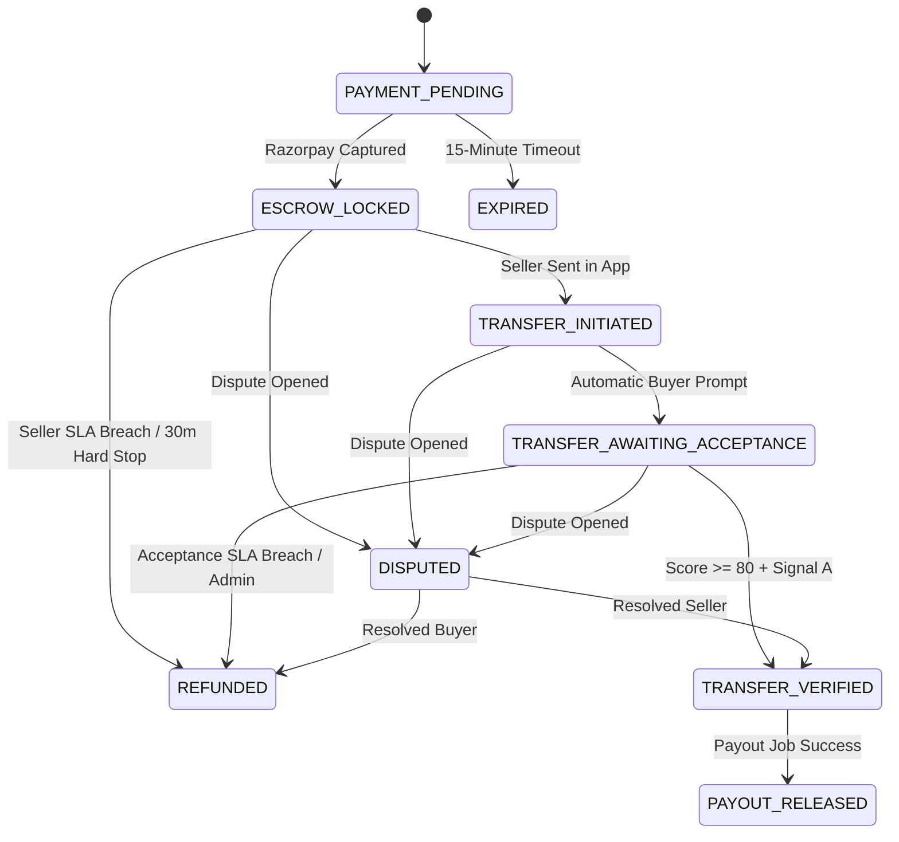

# TicketPass — Verified Ownership Transfer Marketplace

> **Tagline:** Verified ownership transfer marketplace for sold-out live events in India.  
> **Target Platforms:** BookMyShow (BMS) & District (by Zomato).

---

## 🛡️ Core Product Architecture: The Non-Hosting Principle

**Tickets NEVER live on TicketPass.**
- **No PDF Downloads, No Barcodes, No Static QR Codes.**
- Event organizers strictly reject static screenshots and PDFs at stadium and arena turnstiles.
- All actual ticket ownership transfer occurs **natively inside the official BookMyShow or District mobile applications**.
- **TicketPass acts as the financial custody escrow layer**:
  1. Holds the buyer's payment in bank-grade escrow.
  2. Coordinates the in-app transfer coordinates and SLA timers.
  3. Verifies ticket receipt using an autonomous multi-signal confidence engine (0–100 score).
  4. Releases the seller's payout only after verified delivery.
  5. Automatically refunds 100% of the buyer's money if the seller fails or recalls the ticket.

---

## ⚡ Financial Integrity & Fee Rules

All monetary values across the entire monorepo are strictly represented as **integer paise** (`₹1 = 100 paise`). Floats are never used for currency.

- **Buyer Platform Fee:** Exactly 5% of ticket resale price (rounded to nearest integer paise).
- **Seller Platform Fee:** Exactly 5% of ticket resale price (rounded to nearest integer paise).
- **Platform Take Rate:** 10% combined platform margin.
- **20% Seller Security Deposit:** Collected when listing is activated. **100% refunded** to seller's registered bank account immediately upon verified ticket receipt. Forfeited only if seller no-shows, cancels in-app, or breaches transfer SLAs.

---

## 🔄 Strict Order State Machine

Order state changes are governed by a centralized, transactionally-isolated `OrderStateMachine` with optimistic locking (`version` column) and immutable `AuditLog` writes:



---

## 🧠 Autonomous Verification Confidence Engine (0–100)

Escrow payout is unlocked **only** when the composite confidence score reaches **$\ge 80$** AND explicit buyer confirmation (Signal A) is verified:

| Signal | Description | Weight |
|---|---|---|
| **Signal A** | Buyer Explicit Confirmation (Friction last-4 digit match) | **30 pts** |
| **Signal B** | Buyer App In-Screen OCR Scan (Booking ref & venue matched) | **20 pts** |
| **Signal C** | Seller Initiated Screenshot OCR (Transfer sent status matched) | **10 pts** |
| **Signal D** | Timing Consistency within SLA window (BMS: 2h / District: 1h) | **10 pts** |
| **Signal E** | Seller Reputation Score & Tier (Elite / Verified / Trusted) | **10 pts** |
| **Signal F** | Anti-Fraud Clearance (No perceptual image hash matches, clean IP) | **10 pts** |
| **Signal G** | Government KYC Identity Verified (DigiLocker direct / Aggregator) | **10 pts** |
| **Total** | Multi-Signal Confidence Score | **100 pts** |

---

## 🪪 Section 21 — Government Identity Verification (DigiLocker KYC)

Mandatory user-consented, government-sourced identity verification for buyers and sellers before transacting. Compliant with Digital Personal Data Protection (DPDP) Act 2023.

### Going Live with Real DigiLocker

To switch from the built-in development mock (`mock`) to live government or aggregator verification:

1. **DigiLocker Direct (MeitY)**:
   - Register as an authorized requester on the [National DigiLocker Portal](https://partners.digitallocker.gov.in/).
   - Obtain Partner Organization credentials (`CLIENT_ID` and `CLIENT_SECRET`).
   - Register the production OAuth 2.0 PKCE callback: `https://your-domain.com/verify-identity/callback`.
   - Set environment variables:
     ```env
     KYC_PROVIDER=digilocker_direct
     DIGILOCKER_CLIENT_ID=your_registered_client_id
     DIGILOCKER_CLIENT_SECRET=your_registered_client_secret
     DIGILOCKER_REDIRECT_URI=https://your-domain.com/verify-identity/callback
     DIGILOCKER_BASE_URL=https://digilocker.meripehchaan.gov.in/public/oauth2/1
     KYC_SALT=your_cryptographically_secure_random_salt_hex
     ```

2. **Aggregator Provider (Setu / Cashfree / Decentro / Karza)**:
   - Set `KYC_PROVIDER=aggregator`.
   - Configure aggregator API key and webhook endpoints:
     ```env
     KYC_AGGREGATOR_API_KEY=your_aggregator_api_key
     KYC_AGGREGATOR_BASE_URL=https://api.setu.co/digilocker
     ```

3. **Development Mock (`KYC_PROVIDER=mock`)**:
   - Zero configuration required. Emulates real OAuth 2.0 PKCE authorization, user consent screen, age checks, and duplicate fingerprint detection.
   - Interactive profile picker available at `/dev/mock-digilocker`.

### DPDP Act 2023 Data Storage & Privacy Matrix

| Data Element | Stored in TicketPass DB? | Purpose / Retention |
|---|---|---|
| **Full 12-digit Aadhaar** | ❌ **NEVER STORED** | Forbidden under Aadhaar Act & DPDP Act 2023 |
| **Biometric Data** | ❌ **NEVER PROCESSED** | Zero biometric collection |
| **Original XML / PDF Docs** | ❌ **NEVER SAVED** | Ephemeral memory parsing only, immediately discarded |
| **Masked Aadhaar (Last 4)** | ✅ Yes (`XXXX-XXXX-1234`) | For user friction verification dialogs |
| **Salted SHA-256 Fingerprint** | ✅ Yes (`hash(name\|dob\|last4\|salt)`) | Anti-fraud multi-account and self-dealing detection |
| **Verified Full Name** | ✅ Yes | Fuzzy matched against Bank Account holder name ($\ge 80\%$) |
| **Age Verification Flag** | ✅ Yes (`isOver18: boolean`) | Legal transaction capacity enforcement |
| **DPDP Consent Audit Record** | ✅ Yes | Timestamp, IP address, user agent, consent version |

---

## 🎨 Section 22 — Nike-Grade Art Direction

TicketPass implements an uncompromising native-app art direction inspired by the Nike/SNKRS app, Apple product pages, and StockX:

- **Tokens:** Pure dark-first palette (`--bg #000000`, `--surface #111111`, `--surface-2 #1A1A1A`, `--line #262626`).
- **Accent:** Single VOLT accent (`#C8FF00`) used exclusively for live scarcity badges, countdown numerals, confidence gauge indicators, and active states.
- **Typography:** Archivo variable font with condensed display weights (62–75 width, 800–900 weight, uppercase) for hero headers and tabular numerals for currency.
- **Zero Card Chrome:** Flat surfaces separated strictly by 1px borders, generous whitespace, and zero drop shadows.
- **Hard Bans:** Zero emojis, zero purple/indigo SaaS gradients, zero stock photos, zero spinners (shape-matched skeletons only), zero toast stacks $> 1$.
- **Interactive Component Showroom:** Inspect every primitive and responsive state live at `/design`.

---

---

## 🚀 Quickstart Guide

### 1. Prerequisites
- [Docker](https://docs.docker.com/get-docker/) & Docker Compose (Recommended)
- Alternatively: Node.js 20+ LTS, PostgreSQL 16+, Redis 7+

### 2. Launch with Docker Compose
Clone the repository and spin up the complete containerized stack:

```bash
# 1. Clone & enter workspace
git clone https://github.com/ticketpass/ticketpass.git
cd ticketpass

# 2. Copy environment file
cp .env.example .env

# 3. Spin up PostgreSQL, Redis, NestJS Backend & Next.js Frontend
docker compose up -d

# 4. Seed database with events, listings, and demo users
docker compose exec backend npm run db:seed
```

- **Frontend Marketplace:** `http://localhost:3000`
- **Backend API & WebSockets:** `http://localhost:4000/api/v1`
- **Interactive Swagger API Docs:** `http://localhost:4000/api/docs`

---

## 👥 Demo Personas for Instant Testing

To test the complete platform without entering passwords or setting up payment gateways, use the **1-Click Persona Switcher** on the navbar or login screen:

| Role | Email | Capabilities |
|---|---|---|
| **SuperAdmin** | `admin@ticketpass.dev` | Dispute resolution, manual overrides, force refunds, system audit trail |
| **Verified Seller** | `seller.verified@ticketpass.dev` | Score: 94/100, instant 2-minute escrow payouts, active listings |
| **Trusted Seller** | `seller.trusted@ticketpass.dev` | Score: 78/100, active BookMyShow transfers in progress |
| **Active Buyer** | `buyer.one@ticketpass.dev` | Real-time transfer acceptance, friction checks, escrow protection |

---

## 📱 BookMyShow vs District Transfer Mechanics

### BookMyShow (BMS)
- **Transfer Window:** Unlocks ~48 hours before event start.
- **Recipient Selection:** Seller picks the receiver **from their smartphone contacts list**.
- **Important Workflow:** The seller must first save the buyer's phone number into their phone address book before initiating the transfer in BookMyShow.
- **Irrevocability:** Seller can tap "Cancel request" *until* the buyer accepts in BMS. Escrow is strictly locked until the buyer confirms acceptance.

### District (by Zomato)
- **Transfer Window:** Closes ~6 hours before event start.
- **Recipient Selection:** Seller enters the buyer's 10-digit mobile number directly.
- **Important Workflow:** Buyer sees tickets under *My Bookings > Transferred Tickets* and taps "Accept".
- **Anti-Scam Notice:** Once accepted, only the buyer can transfer back. The UI strictly warns buyers to **never reverse-transfer tickets**, even if someone claims it was sent in error.

---

## 🧪 Testing Suites

```bash
# Run backend unit, integration, and E2E state machine tests
npm run test --workspace=apps/backend

# Run frontend component logic tests
npm run test --workspace=apps/frontend

# Run strict TypeScript compiler verification across all workspaces
npm run typecheck
```

---

## 📄 License & Compliance

Copyright © 2026 TicketPass India. All rights reserved.  
TicketPass is an autonomous escrow protocol and has no affiliation with BookMyShow, Bigtree Entertainment, District, or Zomato Limited.
